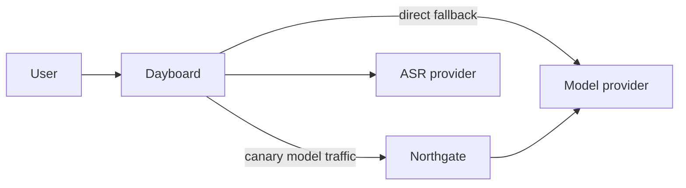
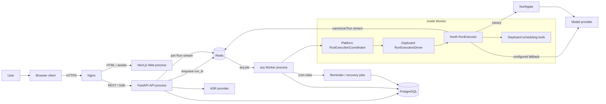
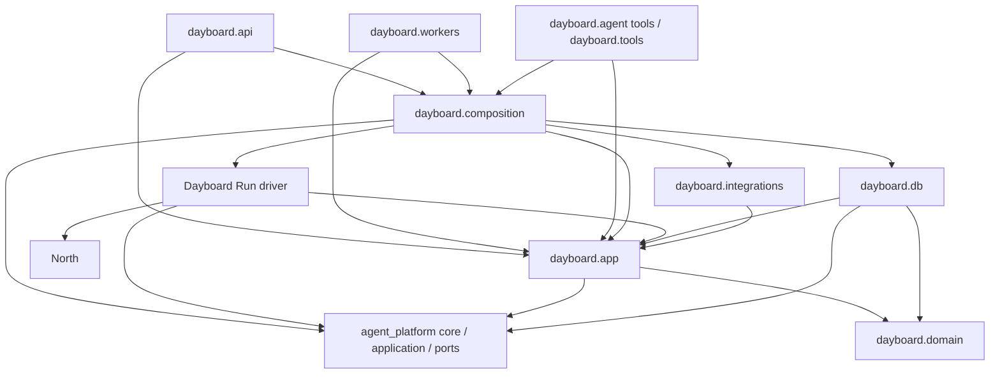
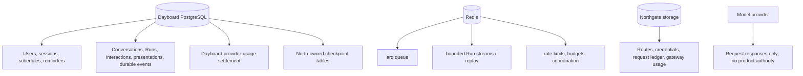

# 当前架构

本文档描述 `main` 上已实现的系统，不描述历史阶段或推测性的替代方案。运行传输细节见
[run-lifecycle.md](./run-lifecycle.md)，产品语义见 [product-model.md](./product-model.md)，代码放置契约见
[module-map.md](./module-map.md)。

下面的每个视图都回答一个问题。系统上下文展示外部系统；部署视图展示运行时进程；源码依赖展示导入关系；所有权视图展示权威归属。不要把这些视图合并到一张图中。

## 系统上下文

North 和 Agent Platform 是 Dayboard 代码边界内的库，不是分别运维的产品。Northgate 是独立的网络服务。在网关迁移完成前，生产模型流量可以使用 Northgate canary 路由，或使用已配置的 direct-provider fallback。



## 部署与运行时组件

Docker Compose 部署一个 Web 进程、一个 API 进程和一个 arq Worker 进程。North 在 Worker 内执行。命令任务、过期 Run 恢复、幂等清理和 Reminder cron 任务都共享该 Worker；`Reminder Worker` 是逻辑角色，不是另一个容器。



PostgreSQL 是账户、日程、会话、Run、持久化 Run 事件、提醒和 provider usage 的事实来源。Redis 负责队列投递、限流、协调以及有界的实时 StreamBridge 重放。Redis 不是权威的产品存储。
会话初始化会从 PostgreSQL 解析所有者的 primary Thread；浏览器本地状态不能在不同设备之间创建独立的历史边界。
primary Thread 由部分唯一数据库索引保护。会话消息是 Thread 有序的 `agent_run_events` 日志中
`category=message` 的行，使用游标分页而不是无界的历史响应；刷新和跨设备访问时 PostgreSQL 仍然是权威来源。
`agent_runs` 负责状态、时间戳、错误和有界的列表摘要，而不是完整的输入或输出正文。
Thread 的生命周期和角色彼此正交：`status` 是受约束的 `active | archived` 生命周期，而 `is_primary` 标识所有者唯一的产品会话。非 primary 的评估 Thread 是 active 生命周期记录，不是第三种伪状态。新 Run 要求 Thread 处于 active；归档历史仍可读，但不能接受新命令。

## 所有权

| 边界 | 负责 | 不得负责 |
| --- | --- | --- |
| Web | 已认证的展示、录音手势、REST/SSE 客户端 | 意图策略、可信身份、持久化 |
| FastAPI | auth、校验、用户上下文、直接读写、Run 创建、SSE framing | 长时间运行的 Agent 执行 |
| Worker | 队列任务执行、依赖组装、过期 Run 恢复、提醒投递 | 浏览器会话 |
| North | 通用 Agent loop、模型/工具执行、规范的运行时流 | Dayboard 产品概念 |
| Agent Platform | identity、Conversation/Run contracts、生命周期协调、持久化 ports | North 或 scheduling concepts |
| Dayboard Agent | prompt、七个 scheduling tools、North adapter、安全结果投影 | 用户身份或由模型直接授权的写入 |
| Services/repositories | 确定性规则、受范围约束的事务、乐观并发 | 自然语言解释 |
| PostgreSQL | 持久化的产品和执行状态 | 队列投递或实时扇出 |
| Redis | arq queue、rate limits、locks、Redis Streams | 持久化的产品事实 |

Agent Platform 和 North 是彼此独立的底层能力；任何一方都不导入另一方。Dayboard 依赖二者，并通过由 Dayboard 拥有、实现 Platform `RunExecutionDriver` port 的 adapter 将它们桥接起来。运行时回调和结果通过声明的接口流转，不反转源码依赖。North 不理解应用身份或持久化；Agent Platform 不理解 North events、calendars、tasks、scheduling prompts 或 Dayboard UI。

## 源码依赖方向

下面的箭头表示源码导入，而不是运行时回调或数据流。外层入口和 adapter 依赖内层契约。Composition 是连接具体 SQLAlchemy、North、settings 和 provider 实现的唯一通用位置。序列化的 Agent tool boundary 也是外层入口，并且可以为一次 tool transaction 请求一个已组装的 Scheduling scope。



`dayboard.domain` 不导入任何外层。`agent_platform` 既不导入 Dayboard，也不导入 North。Dayboard 拥有通过 North 实现 Platform execution port 的 driver。

## 后端形态

当前，可复用的 application package 拥有共享的 identity 和 Conversation/Run contracts：

```text
agent_platform.core          identity, Conversation/Run, Interaction, Presentation, execution outcome
agent_platform.ports         persistence-neutral stores, Unit of Work, Run execution driver
agent_platform.application   Conversation/Run lifecycle, submission, idempotency, execution coordinator
```

Dayboard API package 按职责拆分：

```text
dayboard.api           HTTP, SSE, request and response schemas
dayboard.app           product use cases and deterministic command orchestration
dayboard.composition   outer process wiring, database adapters, and FastAPI dependencies
dayboard.agent         prompt, North assembly, Run driver, and result projection
dayboard.domain        product models and deterministic validation
dayboard.tools         thin Agent-facing adapters
dayboard.db            SQLAlchemy models, repositories, sessions
dayboard.workers       arq Run and reminder jobs
dayboard.integrations  ASR and external provider adapters
```

可信 `UserContext` 从已认证的 server session，或从由 token digest 和 user ID 配置的专用 Eval Bearer identity 解析。Eval authentication 会在每次请求中重新验证 active database user；不会接受调用方提供的 identity fields。User ID、timezone、thread、Run、operation keys 和 permissions 由 runtime 注入，永远不会暴露为模型提供的 tool arguments。Repository queries 按 user ID 限定业务数据范围。

Dayboard 的 composition roots 将 Platform Conversation 和 Run services 连接到 PostgreSQL adapters。`dayboard.composition.platform` 构建显式的 per-session Platform scope，以及用于短时 runtime-journal transactions 的新 `PlatformUnitOfWorkFactory`。`dayboard.composition.commands` 构建无存储的 command application service，而 `dayboard.composition.runs` 为每个已持久化的 Run 构建一个 North driver，并提供其 stream bridge、可信 Agent factory、Provider Usage settlement port 和 budget guard。Platform 负责 persistence use cases、分页、状态转换和生命周期事件策略；adapters 负责 SQLAlchemy rows、constraint translation、user-scoped queries 以及单个 database operations。Dayboard 的 clarification service 负责 scheduling candidate validation、local-time projection、public state filtering 和面向用户的 choice text。

Dayboard scheduling 使用独立的 product-owned Unit of Work。`SchedulingService` 和 `ScheduleQueryService` 只依赖 scheduling store ports 和 domain objects；SQLAlchemy row mapping 留在 `dayboard.db`。Calendar/task writes 与对应的 Reminder Outbox replacement 通过 `SqlAlchemySchedulingUnitOfWork` 共享一个 `AsyncSession`。application service 从不 commit。API 在一次完整的 direct mutation 后 commit，而序列化 Agent tool boundary 只有在其 receipt 和 presentation artifact 构建完成后才 commit；任一边界失败都会回滚整个 transaction。不存在 `SchedulingService(session)` compatibility constructor。

Reminder inbox 和 delivery processing 使用另一个 product-owned Unit of Work。application service 依赖 delivery 和 source-projection ports，接收 domain snapshots 而不是 SQLAlchemy rows；`dayboard.composition` 将这些 ports 连接到 API 和 Worker 进程使用的 SQLAlchemy Unit of Work。API mutations 和 Worker 拥有 commit boundary。Due processing 首先读取 candidate deliveries，按稳定顺序锁定 user-scoped source rows，然后才 claim 仍然到期的 Reminder rows。这与 Scheduling 的 source-then-delivery lock order 一致，使并发 rescheduling 具备线性化语义，而不会把旧 reminder 与尚未提交的新 source 混在一起。Source checking 以及向 `delivered`、`expired` 或 `cancelled` 的 transitions 在一个短 database transaction 中完成。跨越外部 notification provider 时不会持有 transaction；未来的 Web Push adapter 必须在网络投递前 commit claim，并在第二个 transaction 中完成结果。仅属于 queue 的 states 不会暴露为 inbox entries。

Voice transcription 使用自己的 product-owned Unit of Work 和 application-owned ASR provider port。application service 首先提交 user-scoped 的 `processing` transcript，在没有打开 database transaction 的情况下调用 external provider，然后恰好提交一次终态的 `completed` 或 `failed` transition。Terminal updates 只锁定并匹配仍处于 `processing` 的 rows；repository adapters 返回 domain transcripts，并将 ORM rows 与 provider request metadata 保留在 `dayboard.db` 内。`dayboard.composition.voice` 是唯一将 application service 连接到 SQLAlchemy Unit of Work 的模块。

Account Recovery 使用单独的 Dayboard-owned Unit of Work，因为 credentials 和 reset tokens 是全局用户身份数据，而不是 user-scoped scheduling records。application service 负责 CSPRNG token generation、SHA-256 token digests、password-hasher orchestration 和 expiry policy，但从不导入 SQLAlchemy 或 commit。API 在安排 email delivery 或删除 browser cookie 之前，提交 token issue 或 successful consumption。Repository operations 首先锁定 `UserRow`，再重新验证并锁定 reset tokens 和 credentials。Login 首先只读取 credential snapshot，结束该 read transaction，然后在 worker thread 中验证 password，期间不持有 database lock。随后，一个短 write transaction 获取同一个 User-row gate，重新验证 password hash 和 active account state，并创建 Session。因此，并发 reset 要么使 snapshot 失效，要么撤销 reset 之前提交的 Session。Password update、所有 unused-token consumption 和所有 active-Session revocation 要么一起 commit，要么一起 rollback。Raw reset tokens 只存在于 outbound reset URL 中，从不存储。

Provider Usage 在 Run 到达其权威终态后，通过一个狭窄的 settlement port。SQLAlchemy settlement adapter 打开自己的短 Session，将 SQL 委托给 repository，并在没有 feature-specific Unit-of-Work 或 application service 的情况下 commit 或 rollback。Typed aggregates 和 storage-neutral settlement results 跨越该 port；SQLAlchemy rows 保留在 `dayboard.db` 中。PostgreSQL 通过对可信 Run 执行 user-scoped 的 `INSERT ... SELECT` 来插入，因此错误的 user 无法创建记录或占用唯一的 `(user_id, run_id)` key。并发 settlement 具有幂等性且不可变：恰好一个 transaction 创建 aggregate，且只有该 winner 可以协调之前的 Redis budget reservation。Usage persistence 或 budget-reconciliation failures 会被记录，但不会改变 completed 或 failed Run outcome。

Platform 定义狭窄的 Conversation、Run 和 Idempotency Unit-of-Work ports，以及它们组合后的 transaction boundary。Dayboard 的 composition root 使用一个 `AsyncSession` 实现这些 ports。Command submission 现在会原子地 claim idempotency key，resolve 或 create Thread，创建 Run 和 `run.created` event，并追加 `message.human` event。Run lifecycle transitions 与 durable conversation updates 共享该显式 Unit of Work。PostgreSQL 的 Run-event sequence allocation 会锁定 parent Thread，因此不同 Run 的 events 不能选择相同的 Thread-level `max(seq) + 1` 值。

`RunExecutionCoordinator` 负责通用 execution lifecycle。它在调用 external work 前提交 `queued -> running`，等待模型前结束任何 read transaction，并使用 row lock 原子地持久化 terminal Run state、assistant message 和可选的 Interaction。注入的 Dayboard driver 负责 North execution、runtime-event projection、schedule presentation assembly、usage settlement 和 StreamBridge publication。其 runtime journal 为每个 durable event 打开一个新的 Platform Unit of Work，而不是共享 Run 的 main session。North lifecycle callbacks 传递 typed `RuntimeExecutionResult`；Dayboard 在 North 发出 end sentinel 之前将其投影为 Platform outcome，因此浏览器观察到 stream completion 时，PostgreSQL 已经处于 terminal 状态。Redis 只携带 `run_id`；worker 从 Run 重新加载 user ID 和 Thread，再从 event journal 加载 execution input，并为该 Run 组装新的 driver。普通 turn 执行 `message.human` content；clarification continuation 则可以使用独立且可信的 `agent.input` event，同时在 conversation history 中保留安全的面向用户文本。

Platform 拥有带版本的 `PendingInteraction` envelope 及 compare-and-consume lifecycle，而 Dayboard 拥有并校验带版本的 clarification payload。Clarification continuation 在一个 transaction 中完成 idempotency claim、expected-state-version consumption、Run 和 `run.created` event 以及 user message。相同的 retries 会在要求已经 consumed 的 Interaction 之前找到现有 Run；相互竞争的 choices 不能同时创建 continuation。公开的 Dayboard state schema 只包含 presentation options，从不包含可信的 candidate IDs 或 row versions。North 可以在 per-Run graph state 中暂存 `clarification_request`，但只以 typed `ClarificationRequest` 的形式暴露给 Dayboard。Dayboard 将它与当前 Run 的澄清工具通过候选组 key 明确选定的可信搜索快照组合，而不是从 presentation parts 推断候选，也不解释 graph dictionaries 或 ToolMessages；具体协议见 [Agent 工具规范](agent/tools.md)。该 signal 不是 durable application truth：Platform `PendingInteraction` 是 refresh、跨设备恢复、expiry 和 CAS consumption 的唯一权威。

Platform 还拥有通用 `PresentationEnvelope` 的 identity、schema version、persistence 和 replay contract。Dayboard 拥有 `dayboard.schedule-results@1`，校验每个 schedule part，并只将该已知 kind 和 version 投影到 public message API。PostgreSQL 将 envelope 存储为独立的 kind、version 和 JSONB payload columns；database constraint 只允许 assistant messages 携带 presentation。Run status 不会复制到 payload，因为 Run row 才是权威。未知的 product kinds 或 versions 对 Platform 保持不透明，不会被解释为 Dayboard cards；已知 Dayboard version 的 malformed payload 会校验失败。

持久化 Run-event extensions 通过 `EventExtensionEnvelope(kind, schema_version, payload)` 遵循同一所有权规则。通用的 event type、category、content 和 ordering 仍是 Platform fields。Dayboard 的 North adapter 构造 typed model/tool payloads，而 Platform 在 persistence 前构造 failure 和 interaction-state payloads。PostgreSQL 分别存储 extension kind、version 和 JSONB payload，并拒绝不完整的 envelopes。面向用户的 SSE 只接收投影后的 product status，永远不会暴露 diagnostic extension payload。

architecture check 强制 Platform Core、Ports 和 Application 的 import direction，阻止 Dayboard Domain 和 Application 导入外层 product/framework layers，并确保 Run driver 独立于 settings、persistence 和 composition。显式的 composition modules 负责连接这些依赖。

写入使用 PostgreSQL transactions。Scheduling mutations 通过 `expected_row_version` 使用乐观并发；可重试的 Agent writes 也使用 server-derived operation identities。Schedule mutation 与其 pending-reminder cancellation/replacement 属于同一个 transaction，因此二者不会有任何一个脱离另一个而存活。

## Agent 边界

自然语言分类发生在模型的 tool-calling turn 中。不存在 keyword classifier 或 second routing model。模型会收到有界的 conversation context、精确且可信的 local date context、scheduling policy 和当前绑定的 tool schemas。

模型可以提出 actions，但只有 tools 能修改 product data。Tool wrappers 注入可信 context 并调用 services；成功的 tool result 以已提交的 database object 为依据。

模型可见的 business tools 是：

```text
create_calendar_entry
search_calendar_entries
reschedule_calendar_entry
cancel_calendar_entry
create_task_item
search_task_items
update_task_item
```

`ask_clarification` 是 runtime interaction tool，而不是 scheduling business tool。搜索和写入后保留完整工具集合，以继续依赖步骤与跨领域操作；连续失败的工具批次最多允许一轮恢复。见 [Agent Tool Contract](./agent/tools.md)。

## 前端形态

Web application 使用 Next.js、React、TypeScript 和本地 shadcn/ui components：

```text
app/page.tsx                         route entry only
features/workspace/DayboardApp.tsx  page orchestration and layout
features/chat/api.ts                typed Conversation and Run REST boundary
features/chat/useConversationSession.ts
                                   Thread, history, active Run, command, and clarification lifecycle
features/chat/runEvents.ts          validated SSE-to-RunEvent decoder
features/chat/useRunStream.ts       EventSource lifecycle and typed Run reducer
features/schedule                   TanStack Query schedule cache and interactions
components/ui                       CLI-managed shadcn primitives
lib/api/schema.d.ts                 generated FastAPI OpenAPI types
lib/api/typedClient.ts              openapi-fetch client and shared error middleware
```

具名 SSE events 在进入一个 reducer 前会经过校验并转换为有区分的 `RunEvent` union。EventSource transport callbacks 不会检查任意 payload fields，也不会独立组装 message、progress 和 schedule state。持久化的 schedule data 仍由 TanStack Query 在 server 端提供；reducer 只保存 conversation presentation state 和 schedule invalidation revision。实时 schedule parts 和刷新历史共享生成的 `ScheduleResultPart` contract；持久化 messages 暴露 typed versioned presentation，而不是手写的 metadata mapping。

API transport types 使用 `npm run api:types` 生成。手写代码从 `lib/api/types.ts` 使用 aliases，所有普通 Web REST endpoints（包括 Auth、Voice、Conversation 和 Run recovery calls）都使用 `openapi-fetch`。EventSource framing 和具名 Run-event payload validation 仍是独立的 SSE protocol boundary，而不是强行通过 REST client。API CI job 直接从当前 FastAPI application 导出 OpenAPI；Web CI job 针对该 artifact 运行 `npm run api:types:check`，因此 schema drift 会在 build 或 deployment 前失败。生成文件不会编辑，并免于 600-line ESLint limit。所有手写的 TypeScript 和 TSX files 都限制在 600 行以内。

Dayboard theme colors 来源于 `--dayboard-color-*` variables，并映射到 shadcn theme tokens。因此 Feature CSS Modules 和 shared components 使用同一个 light/dark theme source。

## 数据与基础设施



Dayboard PostgreSQL 是 product 和 Platform lifecycle state 的权威来源。North 只拥有该数据库内自己的 checkpoint tables。Redis state 属于运行运维状态，可以重建；Northgate 拥有 gateway accounting，而不是 Dayboard product state；model providers 不拥有任何 Dayboard truth。

PostgreSQL 存储：

- users、credentials、sessions、external identities 和 profiles；
- calendar entries、tasks、reminders 和 delivery records；
- conversation threads、messages、compaction summaries 和 clarification state；
- Agent Runs、持久化 RuntimeJournal events 和 provider usage settlement；
- user ID、audit timestamps、soft-deletion state 和 Run correlation。

Dayboard Alembic 只拥有并比较 Dayboard tables。North 的 checkpoint saver 拥有 `checkpoints`、`checkpoint_blobs`、`checkpoint_writes` 和 `checkpoint_migrations`；这些 tables 与 Dayboard 共用 PostgreSQL database，但明确排除在 Dayboard autogeneration 之外。Forward migrations 将已部署的 physical schemas 与当前 ORM metadata 对齐；CI 在升级干净的 test database 后运行 `alembic check`，因此 owned type、index 和 constraint drift 不会无声累积。

Redis 提供：

- 使用 `run_id` 作为 job identity 的 arq job delivery；
- endpoint 和 provider-budget counters；
- 短生命周期的 coordination；
- 跨进程 canonical message fanout 和有界 replay 所需的 per-Run Redis Streams。

短语音命令通过 application-owned ASR port 进行校验并同步发送，归一化为文本后进入普通 command path。只持久化 transcript lifecycle 和 provider metadata；不持久化 raw audio。生产环境当前使用 Cloudflare `whisper-large-v3-turbo`；Alibaba adapter 仍可用。

Reminder intent 会被归一化为 PostgreSQL delivery rows。Workers 使用 `FOR UPDATE SKIP LOCKED` claim 到期的 in-app deliveries。已认证的 Web reminder center 轮询 typed reminder API，持久化 read state，并可以将 failed rows 返回 Outbox queue。Browser/PWA background Push 被有意延期，因为它需要 Service Worker、持久化 Push subscriptions、Web Push credentials 和独立的 device-delivery lifecycle。当前可选的 browser Notification 由 authenticated foreground polling 驱动，不代表 background delivery。

## 部署

Docker Compose 管理 PostgreSQL、Redis、API、Worker 和 Web。Nginx 终止 public same-site connection，并代理 Web 和 API。Application containers 以 non-root users 运行。Host systemd 管理每日 PostgreSQL backup timer，而不是 application processes。

运维流程见 [Deployment](../operations/deploy.md) 和 [PostgreSQL Backup And Recovery](../operations/postgres-backup.md)。

## 不变量

- PostgreSQL 始终是 product 和 Run 的事实来源。
- Redis Streams 是实时传输和有界重放，不是持久化历史。
- Worker execution 只有一条生产路径：North `RunExecutor` 加 `StreamBridge`。
- RuntimeJournal events 是诊断信息，不是浏览器的规范 message protocol。
- Tool success 以已提交的 persistence 为准；model text 永远不会创建 product state。
- user ID、timezone、Run 和 idempotency context 由 server 控制。
- 未发布的 superseded paths 应被移除，而不是作为 compatibility layers 保留。
