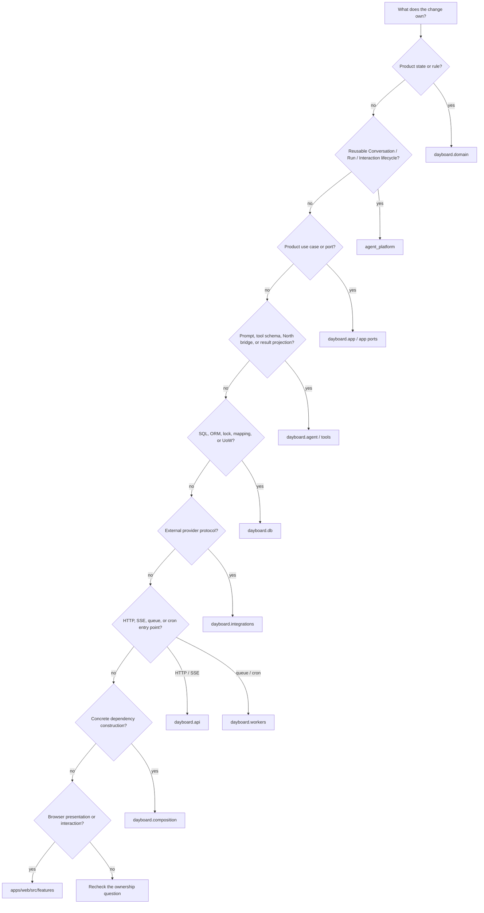

# 当前模块地图

本文档告诉维护者和 coding agents 一项变更应放在哪里。它描述 `main` 上的代码，而不是推测性的 package 拆分。先阅读 [architecture.md](./architecture.md) 了解系统和所有权边界，再在移动或新增 backend code 前使用本文档。

## 变更路由

编辑前先选择最窄的所有者：



| 变更 | 主要位置 | 排除在外 |
| --- | --- | --- |
| Calendar、task、reminder 或 voice state rule | `dayboard.domain` | API、ORM rows、North |
| Product use case 或 deterministic orchestration | `dayboard.app` | FastAPI routes、repositories |
| use case 所需的 storage/provider interface | `dayboard.app.*_ports` | `db`、API schemas |
| Conversation、Run、Interaction、封装生命周期 | `agent_platform` | 调度领域、North |
| Prompt、模型可见 schema、工具绑定、运行时投影 | `dayboard.agent` | Platform、领域实体 |
| Serialized scheduling tool operation | `dayboard.tools` 和 `dayboard.agent.tools` | North、API routes |
| SQLAlchemy row、query、lock、mapping、Unit of Work | `dayboard.db` | application 或 domain modules |
| Services 和 adapters 的具体构造 | `dayboard.composition` | domain 和 Platform Core |
| HTTP、auth、request validation、SSE framing | `dayboard.api` | 长时间运行的 Agent execution |
| Queue 或 cron entry point | `dayboard.workers` | business rules、provider clients |
| ASR、email 或其他 external provider adapter | `dayboard.integrations` | product policy |
| Browser presentation 和 interaction | `apps/web/src/features` | trusted policy、persistence |

如果某项变更看起来要求 domain 或 application module 导入 `dayboard.db`、`dayboard.composition`、FastAPI、SQLAlchemy 或 North，应当引入或复用一个 inward-facing port，再在 composition 中连接它。

## 依赖规则

箭头从 importer 指向 imported code：

```text
api / workers / serialized tool boundaries
  -> composition
  -> app + agent entry points

composition
  -> app + agent + db + integrations + agent_platform

agent Run driver
  -> North + agent_platform ports/application + Dayboard app/domain contracts

app
  -> domain + declared ports + agent_platform contracts/application

db / integrations
  -> app or agent_platform ports + domain/core records

domain
  -> standard library and framework-free value types only

agent_platform
  -> Pydantic and its own core/application/ports; never Dayboard or North
```

`agent_platform` 和 North 是同级的底层依赖。Dayboard 的 Run driver 通过调用 North 实现 Platform execution port。不要为了构造视觉上直线式的 stack 而引入 `agent_platform -> North`。

## Package 契约

### Agent Platform

- **用途：** 持久化、产品中立的 identity、Conversation、Run、idempotency、Interaction 以及 versioned-envelope lifecycle。
- **负责：** framework-free core records、lifecycle services、storage/runtime ports、state-machine invariants。
- **公共契约：** `UserContext`、Conversation 和 Run records、`PendingInteraction`、`PresentationEnvelope`、`EventExtensionEnvelope`、`PlatformUnitOfWork`、`RunExecutionDriver`。
- **允许的依赖：** 自身的 layers 和 framework-free validation types。
- **禁止的依赖：** Dayboard、North、SQLAlchemy、FastAPI、product tools 以及 payload meaning。
- **事务所有者：** Platform application services 声明 atomic groups；注入的 Unit of Work 提交这些 groups。
- **不变量：** opaque product payloads 始终拥有 owner-defined kind 和 schema version。

### Dayboard 领域

- **用途：** 确定性的 Calendar、Task、Reminder 和 Voice state 与 validation。
- **负责：** product entities、timing shapes、statuses、value objects 和 state rules。
- **公共契约：** application ports 和 adapters 消费的 domain records。
- **允许的依赖：** standard library 和 framework-free validation。
- **禁止的依赖：** app orchestration、API、composition、db、workers、tools、North、FastAPI 和 SQLAlchemy。
- **事务所有者：** 无；domain code 不 commit。
- **不变量：** product meaning 保持显式，不会变成通用 JSON `Item`。

### Dayboard 应用

- **用途：** 在 domain records 和 ports 之上执行 product use cases 与 deterministic orchestration。
- **负责：** Scheduling、Reminder、Voice、Account Recovery、clarification、query、recovery 以及面向 command 的 product policy。
- **公共契约：** application services，以及 `*_ports.py` 中的 storage/provider protocols。
- **允许的依赖：** Dayboard Domain 和 Agent Platform contracts/application services。
- **禁止的依赖：** API、composition、db、integrations、workers、North、FastAPI 和 SQLAlchemy。
- **事务所有者：** 外层 API、Worker、serialized tool boundary，或刻意自包含的 settlement adapter；services 不隐藏 commits。
- **不变量：** ORM rows 和 provider-specific response objects 不会跨越 application ports。

### Dayboard Agent

- **用途：** Dayboard prompt、model-visible tools、dynamic binding、North assembly、stream projection、compact receipts、presentation artifacts 和 Run execution bridge。
- **负责：** scheduling language policy，以及 North runtime output 到 Platform execution outcomes 的转换。
- **公共契约：** Agent factory、`DayboardRunExecutionDriver`、result projectors、tool schemas。
- **允许的依赖：** North、Agent Platform public contracts 以及 Dayboard app/domain/tool contracts。Serialized tool construction 属于外层 boundary，可以请求 composed Scheduling scope。
- **禁止的依赖：** 由 Platform 或 North 拥有 Dayboard scheduling semantics；Run driver 导入 API、db、settings 或 composition。
- **事务所有者：** 每个 serialized write tool 只有在其 compact receipt 和 UI artifact 成功构造后才 commit。
- **不变量：** model-visible receipts 包含 local product time；complete UTC entities 保留在 UI artifacts 中，永远不会进入同一 model context。

### 数据库适配器

- **用途：** PostgreSQL schema、SQLAlchemy queries、mappings、locks、constraints 和 concrete Units of Work。
- **负责：** ORM rows，以及 rows 与 framework-neutral records 之间的转换。
- **公共契约：** Dayboard application 和 Agent Platform ports 的实现。
- **允许的依赖：** domain/core records 和 declared ports。
- **禁止的依赖：** natural-language policy、prompt decisions、HTTP presentation。
- **事务所有者：** concrete Unit of Work 暴露 commit/rollback；它不决定 use-case atomicity。
- **不变量：** contract 要求时，每个 product query 都按 user scope 限定。

### 组合根

- **用途：** 从 settings 和 concrete adapters 构造完整的 API 与 Worker scopes。
- **负责：** 仅 dependency wiring。
- **公共契约：** Platform、Runs、Scheduling、Reminders、Voice、Account Recovery 和 Provider Usage 的小型显式 builders；只有调用方需要 grouped lifecycle 或 transaction boundary 时才使用 scopes。
- **允许的依赖：** 构造所需的所有 concrete outer implementations。
- **禁止的依赖：** product decisions 或重复 workflows。
- **事务所有者：** 除选择提供给 outer caller 的 Unit of Work 外，无其他事务所有权。
- **不变量：** 不使用 service locator 或可变的 global request context。

### API 与 Worker

- **用途：** API 负责 HTTP/auth/SSE boundaries；Worker 负责 queued 和 cron entry points。
- **负责：** transport validation、trusted context resolution、dispatch、job restoration，以及在声明的 use-case boundaries 上 commit 或 rollback。
- **允许的依赖：** application services 和 composition scopes。
- **禁止的依赖：** routes/jobs 中的 domain policy，或 API requests 内的 model execution。
- **事务所有者：** 当 service contract 将该 boundary 分配给 endpoint/job 时，由 endpoint/job 提交完整 use case。
- **不变量：** queue payloads 只携带 `run_id`；Worker 从 PostgreSQL 恢复 identity 和 input。

### 集成

- **用途：** concrete ASR、email 和未来的 external-provider adapters。
- **负责：** provider protocol translation、authentication、timeout 和 provider-safe failures。
- **允许的依赖：** application provider ports 和 provider SDKs。
- **禁止的依赖：** domain policy 和 database transaction ownership。
- **不变量：** 外部 network call 期间不会保持 database transaction 打开。

### Web

- **用途：** authenticated mobile presentation、REST/SSE transport、gestures、recording 和 server-state caching。
- **负责：** generated OpenAPI consumption、validated Run reducer、TanStack Query caches 和 UI-only state。
- **禁止的依赖：** intent classification、user identity authority、direct persistence，或将 assistant prose 解析为 schedule objects。
- **不变量：** live 和 refreshed schedule results 使用同一个 versioned presentation contract。

## 能力与事务地图

| 能力 | 持久化权威 | 原子边界 | 关键不变量 |
| --- | --- | --- | --- |
| Command submission | PostgreSQL 中的 Platform Thread/Run/event rows | idempotency claim + Thread resolution + queued Run + `message.human` + `run.created` events | 相同 retry 会解析到已有 Run |
| Run transition | Platform Run 和 durable event | compare-and-transition + corresponding event | model execution 在 transaction 外执行 |
| Run completion | Platform Run、assistant message、presentation、可选 Interaction | terminal state + message + presentation/Interaction | PostgreSQL 在 terminal product event/end sentinel 前提交 |
| Clarification continuation | Platform Conversation state 和 Run | idempotency claim + expected-version consume + new Run/message/event | old Run 保持 terminal；一个 answer 获胜 CAS |
| Schedule mutation | Calendar/Task 和 Reminder delivery rows；Agent 写入另保存 Run receipt | row-version write + Reminder cancellation/replacement；Agent 边界在同一事务保存版本化成功回执及 assistant 卡片 | product write 和 reminder state 不会分叉；Run 锁串行化写入、幂等回执重放和取消 |
| Reminder delivery | Reminder delivery 加 source projection | source lock + due claim + delivered/expired/cancelled transition | 先锁 source；queue states 不是 inbox states |
| Voice transcription | Voice transcript row | commit `processing`；external ASR；独立的 terminal commit | 绝不跨 ASR 持有 transaction |
| Provider usage | 以 user ID 和 Run 为 key 的 immutable aggregate | 独立的 user-scoped settlement transaction | accounting failure 不会替换 terminal Run outcome |
| Password reset | credential、reset tokens、sessions | password update + token consumption + session revocation | raw reset token 从不存储 |

## Event 与 payload 所有权

| 契约 | 封装/生命周期所有者 | 载荷含义所有者 | 消费者 |
| --- | --- | --- | --- |
| `PresentationEnvelope` | Agent Platform | Dayboard | conversation history 和 Web |
| `EventExtensionEnvelope` | Agent Platform | producing Dayboard/North adapter | 仅 durable diagnostics |
| `PendingInteraction` | Agent Platform | Dayboard clarification schema | continuation API 和 Web |
| `ToolMessage.content` | North 传输 | Dayboard 紧凑回执 | 模型上下文 |
| `ToolMessage.artifact` | North transport | Dayboard presentation part | live projection 和 persistence |
| Browser `RunEvent` | Dayboard API/Web boundary | Dayboard safe projector | 一个 Web reducer |

不要用未版本化的 `dict[str, Any]` public protocol 替换其中任何一项。不要让 RuntimeJournal extensions 成为 browser message protocol，也不要通过查询当前 schedule rows 来重建历史 cards。

## 文档维护

只有在 module ownership、allowed dependencies、public cross-module contract 或 transaction boundary 发生变化时，才更新本文档。系统/进程/数据权威发生变化时更新 [architecture.md](./architecture.md)，ordering 或 recovery 发生变化时更新 [run-lifecycle.md](./run-lifecycle.md)。高成本决策的原因记录在 `docs/adr/`；不要在其他目录重复 ADR。

不要为每个 Python file 创建一份 design document。只有当稳定的 public contract 和多个不明显的不变量无法在此处保持清晰时，才新增专门的 module document；将其链接到本地图，并移除重复的 prose。
