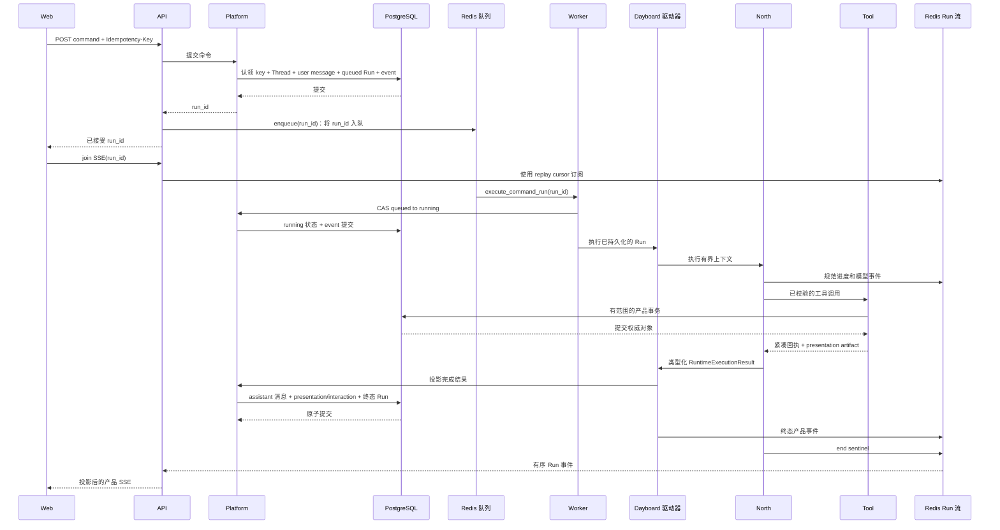
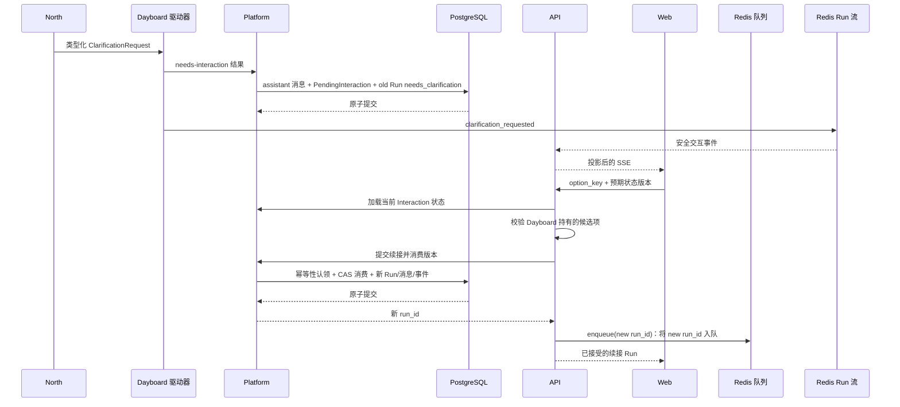

# 当前 Run 生命周期

本文档描述已实现的命令 Run、实时流、持久化和恢复路径。
架构设计依据记录在
[ADR-007](../adr/007-stream-canonical-agent-messages.md) 中。

## 状态模型

Agent Run 具有以下状态之一：

```text
queued -> running -> completed
                  -> needs_clarification
                  -> failed
                  -> cancelled
queued ----------------> failed
queued ----------------> cancelled
```

`completed`、`needs_clarification`、`failed` 和 `cancelled` 对该 Run 而言都是终态。澄清回复会在同一 Thread 上创建后续 Run，而不是重新打开旧 Run。

## 创建与排队

```text
POST /api/threads/{thread_id}/command-runs
  -> 认证并解析 UserContext
  -> 校验 command、Idempotency-Key 和 active Thread lifecycle
  -> 在 PostgreSQL 中持久化 user message 和 queued agent_run
  -> 提交
  -> 仅在 arq/Redis 中将 run_id 入队
  -> 立即返回 run_id
```

请求不会执行模型。队列投递至少一次，因此 Worker 会从 PostgreSQL 恢复 Run，并在开始工作前检查其状态。`run_id` 同时也是队列作业的身份标识，可防止同一个 Run 被重复排入队列。
已归档的 Thread 仍可读取，但会使用稳定的冲突响应拒绝新命令或澄清续接。对于已经接受的请求，即使是幂等重试，也会先解析其已有 Run，再执行本生命周期检查。

## Worker 执行

```text
arq worker 接收 run_id
  -> 打开独立数据库会话
  -> 从 PostgreSQL 加载 Run、user ID、thread 和 input
  -> Platform coordinator 将 queued 转为 running 并提交
  -> 在外部执行前关闭生命周期事务
  -> 组装有界历史、prompt、tools 和受信任上下文
  -> Dayboard RunExecutionDriver 调用 North RunExecutor
  -> North 执行唯一的生产环境 agent.astream 循环
  -> tools 提交有范围的产品变更
  -> 生命周期回调投影 Platform 结果
  -> Platform 原子地持久化 message、Interaction 和终态 Run 状态
  -> Dayboard 发布终态产品事件
  -> North 发布其 end sentinel
  -> 在终态结果之后独立地幂等结算 provider 用量
```

Dayboard 不会直接调用 `agent.astream`。除 North `RunExecutor` 外，不存在同步生产 Worker 或 `stream_agent_once` 路径。

Worker 会为每个作业组合一个新的 Run 驱动器，并始终提供 Redis StreamBridge。运行时 journal 回调会打开新的 Platform Unit of Work 会话，而主 coordinator 会将 Run 生命周期事务边界与这些事件写入分开。

### 命令时序

该时序展示了顺序和权威归属。Redis 队列投递和实时流使用同一 Redis 部署，但承担不同角色。



规范流事件可以在整个执行过程中到达，不会等到数据库终态写入时才发送。成功的工具结果会在其产品事务提交之后到达。终态产品事件和 North end sentinel 会在 Platform 终态事务之后到达。

### 成功操作与中断恢复

Dayboard 的已提交调度写入在既有 Run 事件表中保存 `dayboard.schedule-receipt@1`，与业务数据、Reminder Outbox 和 assistant 结果卡片共享一个事务；不依赖后续 North 工具流事件才能恢复卡片。该产品回执由 Dayboard 解释，Platform 只负责通用的版本化事件存储。详情见 [工具规范](agent/tools.md)。

Driver 在正常完成或失败投影前重读当前 Run 的回执，按实体合并最后成功的快照，避免丢失已提交但尚未经过流投影的结果。过期 running Run 恢复时先锁定并重新检查状态及过期时间，再从回执与现有消息重建卡片，将失败状态、失败事件和 assistant 消息放在同一恢复事务中提交。有成功回执时，提示“部分操作已完成”，要求核实结果后只继续未完成部分，避免重发整条指令。回执是本次操作的历史快照，并不取代当前调度实体的权威状态。旧 Run 没有回执时只能保留已有卡片，不反推历史写入。

## 实时流

North 通过其 Redis `StreamBridge` 发布规范的模型和工具分块。Worker 和 API 针对同一 Redis 部署构造 bridge 客户端。

```text
North RunExecutor
  -> 规范 messages/values 分块
  -> 以 Run 为键的 Redis Stream
  -> FastAPI SSE join endpoint
  -> Dayboard 安全 projector
  -> 浏览器 Run reducer
```

Redis Streams 是有界、会过期并支持跨进程扇出的。PostgreSQL 仍是 Run 状态和会话历史的权威来源。

浏览器可见的事件契约包括：

```text
assistant_text_delta
schedule_item_result
schedule_items_result
run_created
run_started
tool_call_started
tool_call_completed
tool_call_error
clarification_requested
run_completed
run_failed
run_cancelled
stream_replay_gap
```

面向用户的运行时活动遵循 ADR-011 中按调用精确对应的契约。工具进度载荷携带 North 的 `call_id`、安全的产品标签、状态和可选的持续时间。浏览器会更新该调用的开始事件和终态事件对应的一行；对同一工具的两次调用仍然显示为两行。Dayboard 采用 specialist 时，子 Agent 事件还会携带 `task_id`。原始推理、不受限制的工具参数/结果以及 provider 错误不属于该契约。

Run 处于活动状态或失败时，紧凑活动视图会展开；成功完成后会折叠。这是展示状态，而不是 Run 状态。Run 行仍然是权威来源。

安全 projector 会将调度工具结果列入允许列表，并发出类型化快照。创建和变更工具发出 `schedule_item_result`；日历/任务搜索会发出一个包含所有安全匹配项的 `schedule_items_result`。浏览器绝不会解析 assistant prose 来发现日历条目或任务。它会按调度类型和实体 ID 对结果片段执行 upsert，因此同一 Run 中先找到、后被变更的条目只会以最新快照渲染一次。所有命名事件都经过同一个状态 reducer。

模型和摘要生命周期事件会保留在持久化 RuntimeJournal 中，用于用量统计和审计，但不会通过面向用户的 SSE 契约发布。工具 artifact 会独立携带完整的安全展示快照，而模型可见的 ToolMessage 内容保持精简。

## 顺序与持久性

工具的产品事务会先于其成功 ToolMessage 的投影提交。North 发布 end sentinel 之前，其生命周期回调会进入 Platform coordinator，并在一个事务中持久化：

- 终态 Run 状态和结果消息；
- assistant 会话文本；
- 位于 `dayboard.schedule-results@1` presentation envelope 中的安全调度结果片段；
- 必要时的澄清状态；
- 用于诊断和用量关联的持久化 RuntimeJournal 事件。

Platform 只持久化通用执行结果以及展示类型、schema 版本和不透明载荷。Dayboard 在将已知载荷交给 Platform 之前会进行校验，并在通过公共 API 投影历史时再次校验。UI 使用的完整 UTC 调度快照位于 presentation payload 中，而紧凑的本地时间 ToolMessage 回执仅供模型使用。Run 生命周期状态从权威的 Run 行读取，不会在 presentation 中重复保存。

成功写入之后，Agent 仍返回模型判断并执行剩余工作；不会根据最后一个工具批次直接完成 Run。搜索、写入和恢复均保留完整工具面，只有连续两批失败才移除工具并解释部分完成情况。已提交的 artifact 在 Run 进入终态前完成投影和持久化。

`agent_run_events` 是用于持久化消息、生命周期记录和可观测性记录的有序 Thread journal。`message.human` 和 `message.ai` 是权威的会话历史；assistant 事件还携带用于恢复调度卡片的带版本 presentation。Run 行包含生命周期状态和有界的列表摘要，而不是权威的请求/响应正文。Token 增量只保留在实时 StreamBridge 中，不会逐 token 写入。

通用事件字段与产品无关；可选诊断数据使用带版本的 `EventExtensionEnvelope`。North 模型/工具扩展以及 Platform 失败/交互状态扩展，都会由产生它们的 owner 在持久化前完成校验。数据库会拒绝不完整的 envelope。这些记录不会作为主要实时 UI 协议被轮询，其扩展载荷不会经过面向用户的 SSE 发送，非消息运行时记录也不会用于重建调度卡片。

## 重连与重放

SSE endpoint 接受 `Last-Event-ID`，并通过 Redis StreamBridge cursor 订阅。如果 cursor 早于保留的实时历史，bridge 会发出 `stream_replay_gap`。Web 客户端会重新加载已持久化的会话历史；Run 到达终态结果后，客户端会忽略较晚的重放恢复。

如果实时终态事件不可用，SSE endpoint 会从 PostgreSQL 读取终态 Run 状态，并发出相应的终态事件。页面重新加载时会请求 Thread 的 active Run，并在存在时重新加入。

历史 assistant 消息会从其持久化的、带版本的 presentation 渲染调度卡片。实时 SSE 和刷新恢复使用相同的类型化片段，并由浏览器测试验证刷新后卡片保持一致。历史不会通过 `created_by_run_id` 查询当前业务行，因为这些行可能已在原始会话之后发生变化。

## 澄清

`ask_clarification` 写入 North 的单 Run `clarification_request` 信号。`RunExecutor` 会校验该信号，并以携带 `ClarificationRequest` 的类型化 `RuntimeExecutionResult` 完成；Dayboard 不会解释 `thread_data`，也不会扫描最终 ToolMessage。Dayboard 驱动器将该信号和当前 Run 内由澄清工具明确选定的可信搜索候选映射为 Platform 结果；未引用候选组的问题保持普通文字交互，绝不从展示卡片推断候选。调度 presentation 独立构造。随后 Platform 会原子地持久化 `PendingInteraction`、assistant 消息和终态 `needs_clarification` Run 状态，然后 SSE 才会发出问题。

类型化 Thread-state endpoint 返回安全的选项 presentation。选择请求携带会话状态版本和稳定的选项 key。Dayboard 会校验由产品隐藏并持有的候选项，然后 Platform 原子地消费预期的 Interaction 版本，并创建幂等的续接 Run、用户消息和 `run.created` 事件。相同 `Idempotency-Key` 的重试会在读取 Interaction 状态前解析已有 Run；不同或过期的选择会收到冲突响应。



旧 Run 仍然是终态。澄清不会重新打开或恢复旧 Run；答案会在待处理 Interaction 被精确消费一次后，于同一 Thread 上创建新的 Run。

Web 在续接提交被接受后立即移除旧选项，并添加用户选择消息。只有 `CLARIFICATION_CONFLICT` 才显示选项失效并重新读取当前 Interaction；网络或服务临时故障保留原选项，同一选择继续使用相同的幂等键重试。提交成功后若执行流或结果读取失败，提示操作已经提交、可刷新恢复，不再把它解释成选项失效或重新展示已消费的选项。

## 取消与失败

取消是显式操作。排队中和运行中的 Run 会原子地转为 `cancelled`。Worker 会在执行前、生命周期边界期间以及发布结果前检查取消状态。

Provider、工具、队列和意外运行时失败会使 Run 转为 `failed`，并返回安全的面向用户结果。详细关联信息会保留在结构化日志和持久化事件中，但不会记录凭据、cookie、原始音频或完整命令文本。

每个排队中的 Run 只有一次执行尝试。在 coordinator 已持久化终态 `failed` 后，arq 不会自动重放 Run，因为调度工具可能已在后续模型或运行时失败之前提交产品副作用。用户重试会创建新的幂等命令 Run；自动重试需要显式的尝试生命周期以及端到端的工具效果幂等性。

Worker 会扫描过期的活动 Run。排队中和运行中的 Run 使用分别独立的超时规则和按状态区分的原子失败转换。当延迟作业发现恢复操作已经使 Run 进入终态时，它会退出。

## 用量与预算

North 会按模型调用规范化用量。Dayboard 在 Run 准入时预留第一轮请求与输入预算，并通过调用配置中的 `RunModelBudget` 回调，在每次实际模型调用之前检查共享用户/模型额度以及 Run 上限。该回调由 North/LangChain 传递至主模型和独立摘要模型；首次调用补足准入预留，后续调用分别预留请求和 token，不重复收取首次请求。

预留包含完整消息、工具 schema 和输出上限；文本以 UTF-8 字节数保守估算，避免中文按字符数除以四而被低估。这是估算而非提供商 tokenizer 的精确计费。默认每 Run 最多 12 次模型调用、60,000 个累计 token（未知用量保留估算），单次模型输出最多 2,048 token；配置分别为 `DAYBOARD_AGENT_MAX_MODEL_CALLS`、`DAYBOARD_AGENT_MAX_RUN_TOKENS`、`DAYBOARD_AGENT_MAX_OUTPUT_TOKENS`。Provider SDK 自动重试关闭，避免绕过逐次调用检查。即使关闭共享预算，Run 上限仍有效。

回调根据可用的实际用量更新 Run 计数，超出预留的部分补记共享预算；共享固定窗口不退款，失败或未知用量保留预留。预算拒绝在同一 Run 内保持生效；摘要 helper 即使把异常转换为文本，也会在持久化摘要前被 Run driver 拒绝，不能用错误文本覆盖记忆。

Platform 提交终态 Run 结果后，Dayboard 使用新的 Unit of Work 和 `(user_id, run_id)` 上不可变的唯一聚合结算用量。PostgreSQL adapter 从受信任的 Run 推导 user ID，因此不匹配的调用方无法占用该幂等 key。只有新建聚合才协调累计预留之外的剩余差额，不重复收取逐次调用已经预留的 token。用量持久化和 Redis 协调与 Run 完成不具备原子性，不能替代 Run 结果。

如果进程在 settlement `finally` 块之前硬退出，用量仍可能丢失。如果 PostgreSQL 用量提交之后、Redis 协调之前发生崩溃，预留可能不准确。完整恢复需要持久化的用量 outbox 或协调作业；它不会被隐藏在内存重试之后。当前 admission 发生在 Dayboard，而将有范围的 provider-token policy 迁移到 Northgate 仍是未来工作。Northgate 当前的 policy 以 gateway 为范围，因此在它接受受信任的动态身份并原子地执行显式 policy scope 之前，无法替代 Dayboard 的用户/模型 admission。

运维诊断遵循以下链路：

```text
request_id -> user_id -> thread_id -> run_id -> runtime/tool event -> product object
```

Token 和缓存诊断位于
[operations/token-usage-diagnostics.md](../operations/token-usage-diagnostics.md) 中。
